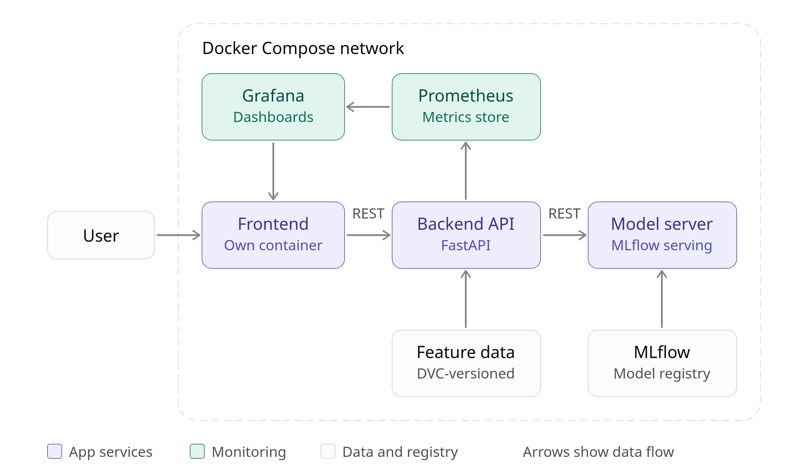
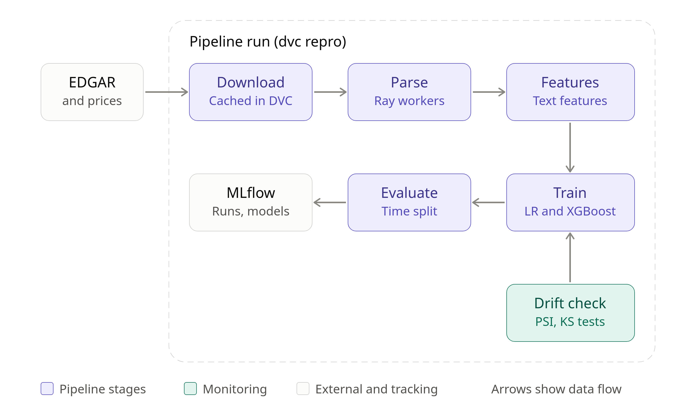
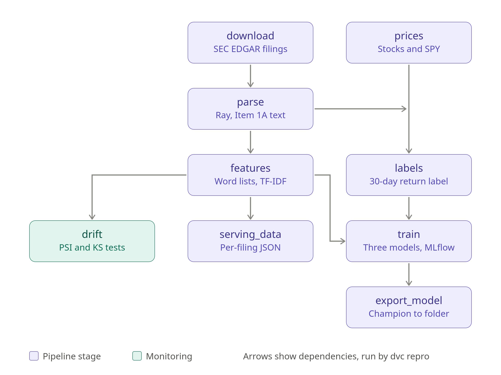
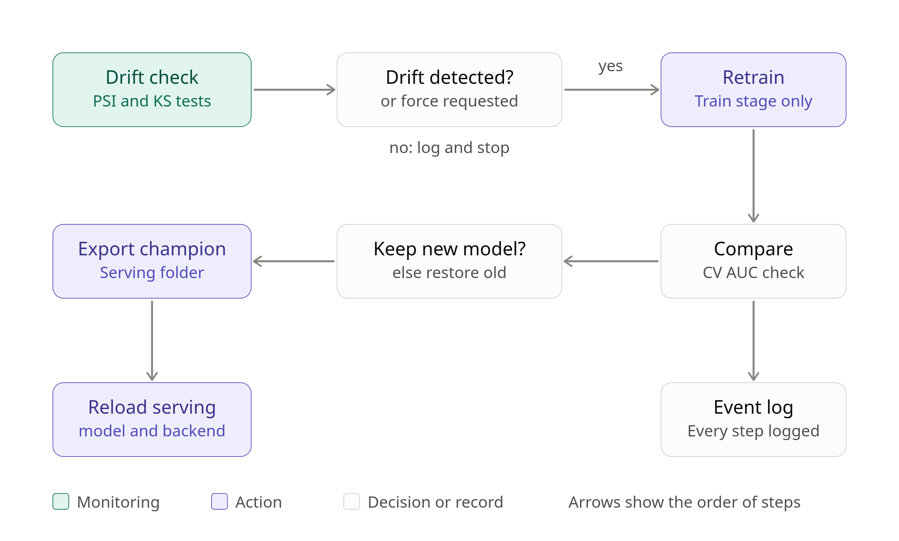

# FilingLens: High-Level Design Document

Eshika Nahata (DA24B004) | Individual project | Version 1.1

## 1. Purpose and Scope

This document explains how FilingLens is designed and why. It covers the architecture, the main design decisions together with the alternatives considered, the data and model design, deployment, monitoring, and known limitations. Endpoint definitions and input/output specifications are in the Low-Level Design document. Testing is covered in the Test Plan and Test Report, and end-user instructions are in the User Manual.

FilingLens turns a US company's annual report (SEC Form 10-K) into a simple, explainable risk signal for a non-technical user. It compares the latest filing with the previous year's, highlights what changed in the risk-factors section, and shows a model-based estimate of how likely the stock is to underperform the market in the weeks after filing. It is **decision support, not financial advice or price prediction**, and the application says so.

## 2. Requirements and Constraints

**Functional requirements**

- A user picks a company and sees a risk signal, a plain-English list of what stands out, a detailed comparison with last year, and the signal across earlier years.
- An operator sees pipeline status, failures, throughput, model comparison, data drift, and recent pipeline events on a console page.

**Course constraints**

- Follow the AI product lifecycle with AIOps practices: automated and versioned pipelines, experiment tracking, monitoring, containerised deployment.
- Recommended stack: Git and DVC, Ray, MLflow, Prometheus and Grafana, Docker and Docker Compose, FastAPI.
- No cloud platforms. Individual project, about one month, alongside other coursework, which is why the scope is deliberately small and every component had to be explainable.

**Quality goals**

- Every result reproducible from a Git commit hash and an MLflow run ID.
- Frontend and backend independent, connected only through configurable REST calls.
- Honest evaluation: leakage-free splits and results reported with uncertainty, whatever they show.

## 3. Architecture Overview

*Figure 1. Runtime architecture. The user reaches only the frontend; the frontend calls the backend over REST, and the backend calls the model server over REST. The backend reads the DVC-versioned feature data; the model server serves the model exported from the MLflow registry. Prometheus scrapes the backend and Grafana shows its data, with panels embedded in the frontend. Each block is described in section 3.1. Not drawn: cAdvisor (container metrics, also scraped by Prometheus) and the MLflow UI container.*

*Figure 2. Pipeline overview. Filings and prices enter the DVC pipeline, are parsed in parallel with Ray, turned into text features, used to train logistic regression and XGBoost, and evaluated on a time-based split, with every run recorded in MLflow. The drift check decides whether retraining is needed (section 3.3).*

*Figure 3. The data and model stages of the DVC graph and their dependencies, as run by `dvc repro`. Not drawn: the continuous-integration stages `lint` and `test` (section 9), which form a separate chain `lint` → `test` → `export_model`. The full graph is in `docs/dvc_dag.txt`.*

### 3.1 Runtime view (what runs when the application is serving users)

| Block | Technology | Responsibility |
| --- | --- | --- |
| Frontend | Streamlit, own container | The only thing the user sees. Calls the backend over REST. Embeds Grafana panels in the console page. Knows nothing about the model. |
| Backend API | FastAPI, own container | Validates input, looks up precomputed features, calls the model server for a score, builds the plain-English explanation, exposes Prometheus metrics. Contains no machine-learning libraries. |
| Model server | MLflow model serving, own container | Serves the exported champion model and returns class probabilities. Knows nothing about the UI or the feature files. |
| Serving data | JSON file produced by the pipeline | Per-filing features, percentile ranks, and the terms whose emphasis changed. Mounted read-only into the backend. |
| MLflow tracking and registry | MLflow with SQLite store | Experiment history and the model registry that holds every trained version. |
| Prometheus and Grafana | Prometheus, Grafana | Metrics storage, alert rules, dashboards. Prometheus scrapes the backend, cAdvisor and itself. |
| cAdvisor | cAdvisor, own container | Reports CPU, memory and liveness of every container, so services without their own metrics endpoint (model server, frontend, MLflow UI) are still monitored. |

### 3.2 Pipeline view (what runs when the system is built or refreshed)

The pipeline is a DVC graph of twelve stages. Each stage declares its inputs, parameters and outputs, so DVC reruns only what is stale.

| Stage | What it does |
| --- | --- |
| lint | Checks the code style with flake8 (continuous integration, section 9). |
| test | Runs the automated test suite with pytest and writes the test summary. `export_model` depends on this summary, so no model is exported from code that fails its tests. |
| download | Fetches 10-K filings from SEC EDGAR (throttled, retried, cached), including filings older than EDGAR's "recent" list. |
| parse | Extracts the Item 1A risk-factors section in parallel with Ray. |
| prices | Downloads daily adjusted closes for the companies and the SPY benchmark. |
| labels | Computes the 30-trading-day abnormal return after each filing and the binary target. |
| features | Builds text features for each filing and its year-over-year changes. |
| train | Trains a baseline, logistic regression and XGBoost; logs everything to MLflow; registers the best candidate. |
| drift | Compares the latest filings' features with the training period (PSI and KS test). |
| eda | Exploratory data analysis: coverage per company and year, data-quality checks, label balance, text lengths, feature distributions and correlations, and train-versus-test shift. Writes `reports/eda/eda.md` with figures. |
| serving\_data | Precomputes everything the backend needs per filing. |
| export\_model | Copies the registry's champion model into a portable folder for the model server and records its SHA-256 checksum. |

### 3.3 Drift and retraining loop

A separate orchestrator runs one monitoring cycle: run the drift check; if drift is detected (or retraining is forced), retrain; compare the new model's cross-validation score with the previous champion's; keep the new model, or move the registry alias back to the previous version if the new one is worse by more than a tolerance; re-export the champion for serving. Each step is written to an event log shown on the console.

*Figure 4. One monitoring cycle: drift check, conditional retraining, promotion or rollback, re-export.*

### 3.4 Interfaces

| From | To | Contract |
| --- | --- | --- |
| Browser | Frontend | HTTP (Streamlit) |
| Frontend | Backend | REST, JSON. URL set by `BACKEND_URL`. |
| Backend | Model server | REST. MLflow `/invocations` with a column-oriented table in, class probabilities out. URL set by `MODEL_SERVER_URL`. |
| Prometheus | Backend | HTTP scrape of `/metrics` every 5 seconds. |
| Prometheus | cAdvisor | HTTP scrape of container metrics every 5 seconds. |
| Pipeline | Backend | Files: serving data, model info, and stage reports, mounted read-only. |

## 4. Key Design Decisions

| Decision | Alternatives considered | Rationale |
| --- | --- | --- |
| Frame the product as decision support with a transparent "what changed" view | Present a price or return predictor | Short-horizon returns are very noisy. A comparison of what changed in a filing is useful and honest even when the model has little predictive power. |
| Hand-built text features with simple models (logistic regression, XGBoost) | Deep language models | Only about 200 training filings are available. Deep models would overfit, and the text intelligence is in the feature engineering. Simple models are also easier to explain. |
| Time-based train/test split with a 45-day embargo | Random split | A random split lets future information leak into training. The embargo ensures no training label window overlaps the test period. |
| TF-IDF fitted on the training period only | Fit on all filings | Fitting on all text would let test-period wording influence the features. |
| Choose the champion by time-ordered cross-validation inside the training period | Choose by test score | Choosing by test score on 58 samples would mostly select luck. The test set is used only for reporting. |
| Ray for parsing | Python multiprocessing, Spark | Each filing is an independent task, so the work parallelises cleanly. Ray was one of the recommended tools and is lighter than Spark for a single machine. |
| DVC pipeline for data, features, models | Makefile or ad hoc scripts | DVC gives versioned data, a declared dependency graph, and reproducible reruns. |
| MLflow for tracking and registry | Custom logging | Required for experiment tracking. The registry's alias mechanism also gives a simple, safe rollback. |
| Export the champion into a plain folder for serving | Serve straight from the registry | The registry stores absolute host paths that do not exist inside containers. A self-contained folder is portable. |
| Log the model with `predict_proba` | Default prediction of class labels | The application needs a probability, not a hard 0/1 answer. |
| Separate frontend, backend and model server containers | One application | Required loose coupling. Each part can change or scale without touching the others. A test checks that the frontend never sees the model server's address. |
| Precompute per-filing features and changed terms in the pipeline | Compute at request time | Keeps the backend small and fast, with no machine-learning libraries and no raw filings. |
| Prometheus custom collector that reads pipeline reports at scrape time | Push gateway | No extra service. The numbers always match the latest pipeline run. |
| Streamlit frontend | Hand-written HTML and JavaScript | Much faster to build as a solo student, and it still meets the loose-coupling requirement by calling only the backend. |
| Drift decision needs both PSI and a KS test, and a minimum share of features | PSI alone or KS alone | PSI is noisy on small batches and KS flags harmless shifts. Requiring both keeps false alarms low. |
| Retraining is a script around DVC, not a DVC stage | A DVC stage | DVC stages run unconditionally. "Retrain only if drift" needs a decision, so a script decides and then calls the DVC stages. |
| Alert rules without Alertmanager | Full alert routing | This is a local demonstration. Rules are evaluated and visible in Prometheus; no notification channel is configured. |
| Continuous integration as DVC stages plus a git pre-commit hook | A hosted CI service such as GitHub Actions | Cloud platforms are not allowed, and the repository has no remote. Making `lint` and `test` DVC stages puts them in the same versioned graph as the data and model, lets DVC skip them when no code changed, and lets `export_model` depend on the test result. |
| cAdvisor for container metrics | Adding a metrics endpoint to every service | The model server (MLflow) and Streamlit have no Prometheus endpoint. cAdvisor covers every container without changing any of them. |
| SHA-256 checksum of the exported model, verified at start-up | Signing the model, or trusting the file | The model is a pickle, which runs code when loaded. A checksum written at export time and checked before serving is simple and catches a model file changed after export. |
| MLproject with a pinned lock file | Only a `requirements.txt` with minimum versions | Minimum versions drift over time. `mlflow run` builds a fresh environment from `python_env.yaml` and `requirements.lock`, so tests run in an environment identical to development. |

## 5. Data Design

### 5.1 Sources and universe

- **Filings:** SEC EDGAR, Form 10-K only (not 10-K/A or 10-Q), roughly five fiscal years per company.
- **Prices:** daily adjusted closes from a free source, plus the SPY index as the benchmark. Downloaded once and versioned in DVC because the source is unofficial and can be unreliable.
- **Word lists:** the Loughran-McDonald finance dictionary (negative, positive, uncertainty and litigious words), downloaded manually under its academic-use licence.
- **Universe:** a fixed list of large US companies. The served dataset contains 54 companies and 318 filings. Five companies on the original list are excluded and the reasons recorded in the ticker list: four for their filing layout (section 5.3) and Exxon Mobil, for which the download returned no 10-K in the date window.

### 5.1a Exploratory data analysis

The `eda` stage regenerates an analysis report (`reports/eda/eda.md`, with figures) every time the data changes, so the analysis always describes the dataset actually used. It checks coverage (filings per company and fiscal year, companies with far fewer filings than the others, missing years), data quality (parse failures, unlabeled filings, filings without a prior year), the label (abnormal-return distribution and class balance by year), text lengths, the feature distributions with their outlier shares and correlations, each feature's correlation with the label against a 95% noise band, and the shift between the training and test periods.

The analysis shaped three decisions. Section lengths are strongly right-skewed, so the model uses the logarithm of the word count. Two readability features are almost perfectly correlated, which is tolerated because the models are regularised or shallow. And the feature-label correlations sit inside or near the noise band, which predicted the weak model result before any model was trained. The coverage check also proves its worth: run on the dataset from before the download fix, it lists exactly the eight companies whose older filings were missing (section 5.2).

### 5.2 Ingestion

EDGAR requires a contact in the User-Agent header and limits request rates. The client reads its contact from an environment variable (never committed), throttles to five requests per second (half the allowed rate), retries transient failures with backoff, writes files atomically, skips files already downloaded, and records every filing, including failures, in a manifest.

EDGAR's submissions file for a company lists only about the latest 1,000 filings in its "recent" block; older filings are in extra pages listed separately. Companies that file many other forms (for example JPMorgan, Meta and Alphabet) reach that limit within a year or two, so the first version of the client silently missed their older 10-Ks. The client now also reads every extra page whose date range overlaps the download window, and removes duplicates. A company with no 10-K in the window gets its own row in the manifest, so it cannot disappear silently.

### 5.3 Parsing

The Item 1A risk-factors section is extracted by pattern matching. The heading also appears in the table of contents and in cross-references, so the extractor pairs each start marker with the first end marker after it and discards spans that are too short to be real sections.

The first full run parsed 281 of 314 filings (89.5%), below the 95% target. (That run predates the download fix in section 5.2, so it covered fewer filings than the current dataset.) Diagnosis showed two distinct causes:

1. **Headings split across formatting tags** (Microsoft, Oracle): text joining inserted spaces inside words. Fixed by joining text only at block-level tags.
2. **No "Item 1A" heading at all** (Intel, General Electric, Honeywell, McDonald's): these annual-report-style filings mention Item 1A only in a cross-reference index at the end. Handling them needs per-company rules.

The four companies in the second group were excluded and the reason documented in the ticker list. After the fix and exclusions, all remaining filings parsed (100%); with the complete download this is 318 of 318. Both numbers are reported, because dropping failing companies and then quoting 100% would be circular.

### 5.4 Label

For each filing: base price is the close on the last trading day on or before the filing date; the end price is 30 trading days later; abnormal return is the stock's return minus the benchmark's over the same dates. Target = 1 if the abnormal return is negative. Filings without 30 trading days of data yet stay unlabeled and are never used for training. Of 318 filings, 316 are labeled and 47.8% are underperformers, so the classes are well balanced.

### 5.5 Features

| Group | Features |
| --- | --- |
| Word shares (Loughran-McDonald) | negative, positive, uncertainty, litigious |
| Readability | Flesch-Kincaid grade level, average sentence length |
| Length | log of risk-section word count, risk section as a share of the whole filing |
| Year-over-year change | change in risk-section length, TF-IDF cosine similarity with last year's section |
| Year-over-year deltas | change in negative, uncertainty and litigious word shares, change in reading grade level |

A filing needs a filing about one year earlier (300 to 450 days) to have year-over-year features. A company's first filing therefore has none and is excluded from modelling, though the application still shows it.

### 5.6 Split

Training uses filings up to 2025-05-17. Filings from 2025-07-01 onward form the test period. The 45 days in between are dropped. This gives 202 training and 58 test filings with both a prior year and a label (264 filings have a prior year).

## 6. Model Design and Evaluation

Three models are trained and logged as separate MLflow runs: a majority-class baseline, logistic regression (standardised, class-balanced), and XGBoost (shallow trees). Parameters, metrics, feature importances, test predictions, the Git commit, a dirty-tree flag and SHA-256 hashes of the data files are logged for every run.

| Model | CV ROC-AUC | Test ROC-AUC (95% interval) | Test accuracy (95% interval) |
| --- | --- | --- | --- |
| Majority baseline | 0.50 | 0.50 | 51.7% (39.7 to 65.5) |
| Logistic regression (champion) | 0.48 | 0.44 (0.30 to 0.60) | 51.7% (39.6 to 63.8) |
| XGBoost | 0.44 | 0.50 (0.35 to 0.66) | 55.2% (41.4 to 67.2) |

**Interpretation.** No model can be distinguished from chance: every 95% interval for test AUC includes 0.5, and the champion's test accuracy equals the majority-class baseline. Cross-validation and the held-out test period agree on this, which points to weak signal and small data, not to a leakage or code problem. Logistic regression became the champion because its cross-validation AUC was higher (0.48 against 0.44). XGBoost happens to score higher on the test period (0.50 against 0.44), but switching to it for that reason would be choosing by test score on 58 filings, which section 4 rules out; the difference is well within noise. A positive-control test, which plants a real signal in synthetic data, confirms the training code recovers signal when it exists. With 58 test filings, the intervals are wide enough that a modest real effect could be present but could not have been detected. The honest statement is "no detectable signal at this sample size".

**Consequences for the design.** The acceptance criterion "beat the majority-class baseline" is not met and is reported as not met. The application labels the score with its uncertainty, shows the descriptive "what stands out" analysis alongside it, and the "what stands out" statements are explicitly descriptive (percentile comparisons with other filings), not explanations of the model score.

## 7. Deployment Design

All services run locally under Docker Compose with one command.

| Service | Image | Port | Notes |
| --- | --- | --- | --- |
| model-server | built from the exported model's pinned requirements | 5001 | Health check on `/ping`. Mounts the model folder read-only. Verifies the model checksum before serving. Non-root user. |
| backend | slim Python, FastAPI only | 8000 | Starts after the model server is healthy. Read-only mounts for data and reports. Non-root user. |
| frontend | slim Python, Streamlit | 8501 | Starts after the backend is healthy. Non-root user. |
| prometheus | official image | 9090 | Loads scrape config and alert rules. |
| grafana | official image | 3000 | Provisioned datasource and dashboard; embedding enabled for the console page. Admin password read from `.env`; anonymous users are read-only viewers. |
| cadvisor | official image | 8080 | Container CPU, memory and liveness for Prometheus. Needs read-only access to the Docker host. |
| mlflow-ui | model image, reused | 5000 | Experiment and registry browser. |

**Environment parity.** All three application images use Python 3.14, the version the models are trained with, so a pickled model is loaded by the same Python that wrote it. The model image installs the exact library versions MLflow recorded at training time; the backend and frontend images install exact (`==`) versions. The development environment is pinned in `requirements.lock`, and the `MLproject` file with `python_env.yaml` lets `mlflow run . -e test` (or `-e train`, `-e pipeline`) build a fresh, identical environment from those pins. Configuration (service addresses, thresholds, file paths, secrets) comes from environment variables, so the same images run anywhere.

**Rollback.** Move the `champion` alias in the registry to an earlier version, re-export, and recreate the model server and backend. Earlier versions are never deleted.

## 8. Monitoring and Observability

| Area | What is measured |
| --- | --- |
| API | request counts by endpoint and status, request latency, risk score distribution, analyses by signal |
| Model server | call outcomes and latency |
| Pipeline | filings processed and failed, parse success ratio, parse throughput, label balance, Ray speed-up, champion scores |
| Data drift | per-feature PSI, drift flag, number of drifted features |
| Events | counts of drift checks, retrains, promotions and rollbacks |
| Containers (cAdvisor) | CPU, memory and liveness of every container, including the model server, frontend, Prometheus, Grafana and the MLflow UI |

Prometheus has three scrape jobs: the backend, cAdvisor and Prometheus itself. Grafana shows all metrics on one dashboard, including container CPU, container memory and the number of containers running, and four panels are embedded in the console page so an operator sees one tool. Prometheus evaluates eight alert rules: backend down, model server errors, model-server container down, any scrape target down, high server-error rate, slow responses, parse success below target, and data drift.

The console page also lists the status of each pipeline stage, the Ray benchmark, the model comparison with confidence intervals, the drift table, and recent events.

## 9. Reproducibility and Versioning

- **Code:** Git. Every training run records the commit hash and whether the working tree was dirty.
- **Data and models:** DVC tracks raw filings, parsed text, prices, labels, features, serving data and the exported model. Parameters live in one file that stages declare as dependencies.
- **Experiments:** MLflow records parameters, metrics, artifacts, and data hashes per run. Random seeds are fixed.
- **Models:** the registry keeps every version; an alias marks the one being served.
- **History:** an append-only event log records drift checks, retrains, promotions and rollbacks.

Any reported result can therefore be traced to a commit, a data version and an MLflow run.

**Continuous integration.** CI runs locally and is built on DVC:

- **`lint` stage:** runs flake8 (maximum line length 120; code formatted with black).
- **`test` stage:** runs the automated test suite and writes `reports/test_summary.json`.
- **Gate:** `test` depends on the lint report, and `export_model` depends on the test summary. `dvc repro` therefore never exports a model from code that fails style checks or tests. The DVC graph (`dvc dag`) shows this chain.
- **Pre-commit hook:** installed by `scripts/install_hooks.sh`. It runs `dvc repro lint test` before every commit and blocks the commit if either fails. Because DVC caches stage results, a commit that does not change code passes immediately.
- **DVC's own git hooks:** they keep the data in step with the code on checkout and push.
- **Fresh-environment check:** `mlflow run . -e test` runs the same tests in a freshly built environment.

## 10. Non-Functional Design

**Performance.** Parsing with Ray (benchmark measured on the 290 filings available before the download fix; the production run on all 318 filings with four workers processed 263.1 filings per minute):

| Workers | Filings per minute | Speed-up |
| --- | --- | --- |
| 1 | 77.1 | 1.00x |
| 2 | 141.5 | 1.84x |
| 4 | 230.4 | 2.99x |
| 8 | 360.6 | 4.68x |

Efficiency falls as workers increase, which is typical when workers share disk and memory bandwidth and machine cores include hyper-threaded ones. The backend answers a request with one model call, and the history view batches all of a company's filings into a single call. Latency is measured in the Test Report against a 1-second 95th-percentile target.

**Reliability.** Unknown tickers, malformed input, and an unreachable model server each return a clear, friendly message with no stack trace. The backend fails fast at startup if its data is missing. Containers restart automatically, and health checks gate startup order.

**Security.**

- **Secrets:** the EDGAR contact and the Grafana admin password are read from a `.env` file that git ignores; `.env.example` documents the keys without values.
- **Least privilege:** all three application containers (model server, backend, frontend) run as a non-root user, and the data, report and model folders are mounted read-only.
- **Model integrity:** the model is stored in a pickle-based format, which executes code when loaded. To guard against a model file that was replaced or corrupted after export, `export_model` writes its SHA-256 checksum, and the model-server container refuses to start unless the file matches.
- **Input validation:** input is validated against a strict pattern, and errors never expose stack traces or internal addresses.
- **Monitoring access:** Grafana allows anonymous read-only viewing for the embedded console panels; editing needs the admin password.
- **Personal data:** none is processed.
- **Not covered:** traffic between services and to the browser is plain HTTP on localhost and is not encrypted (see section 11).

**Maintainability.** Configuration is externalised. The code follows a single style (flake8 with no warnings, formatted with black), enforced by the `lint` stage. It is covered by 130 automated tests, including static checks that the deployment files agree with each other and with the code (for example, that every container runs as non-root and that no password is hard-coded).

**Usability.** The interface uses plain language, explains every figure, states its limits, and handles errors without technical jargon. A help page and a user manual are provided.

## 11. Limitations and Future Work

- **Weak predictive signal.** The model is indistinguishable from chance on 58 test filings. More companies, more years, and quarterly filings would raise the sample size and the chance of detecting a real effect.
- **Narrow universe.** Four companies with non-standard filing layouts and one with no 10-K in the window were excluded. A heading-based fallback extractor could recover them.
- **Retraining window.** Retraining re-fits on the same split window. In real use, new filings would be ingested and the split dates advanced first; the mechanics are identical.
- **Alert delivery.** Alerts are shown in Prometheus but not sent anywhere. Alertmanager would add routing.
- **Price data source.** The free price source is unofficial and could change.
- **Single machine.** Everything runs on one host. Docker Compose services could be moved to Swarm or Kubernetes later, as the guidelines suggest.
- **No encryption in transit.** Services talk over plain HTTP on one machine. A reverse proxy (for example nginx) with TLS in front of the frontend and Grafana would be the next step for any shared deployment.
- **CI runs locally.** The checks run through DVC stages and a git hook on the developer's machine. With a shared repository they could run on a self-hosted CI runner using the same `dvc repro lint test` command.

## 12. Traceability to the Evaluation Rubric

| Rubric area | Where it is addressed |
| --- | --- |
| UI/UX | Section 3.1 (frontend), Section 10 (usability), User Manual |
| Pipeline visualisation | Section 8 (console page, Grafana dashboard) |
| Design principles | Sections 3 and 4, with the interface contracts in 3.4; endpoints in the Low-Level Design |
| Implementation | Sections 7 and 10 (flake8 and black style, security); code, logging, error handling and tests described in the Test Plan |
| Testing | Test Plan and Test Report |
| Data engineering | Sections 3.2, 5 and 10 (Ray parsing and benchmark; EDA stage in 5.1a) |
| Source control and CI | Sections 3.2 and 9 (Git, DVC data and model versioning, `lint` and `test` DVC stages gating the model export, pre-commit hook) |
| Experiment tracking | Sections 6 and 9 (MLflow runs, hashes, registry) |
| Instrumentation and visualisation | Section 8 (Prometheus metrics from the backend and every container via cAdvisor, eight alert rules, Grafana) |
| Software packaging | Section 7 (MLflow serving, MLproject with pinned environment, FastAPI, Docker Compose with separate services) |
| Viva | Section 4 gives the rationale for each major choice; Section 11 states the limits openly |
