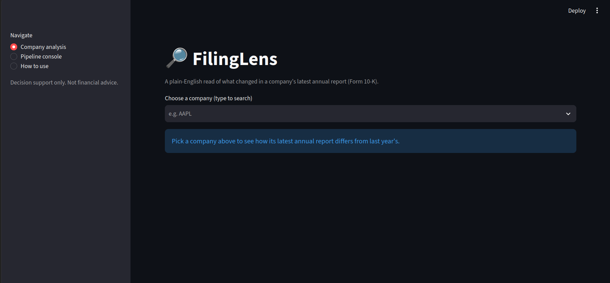
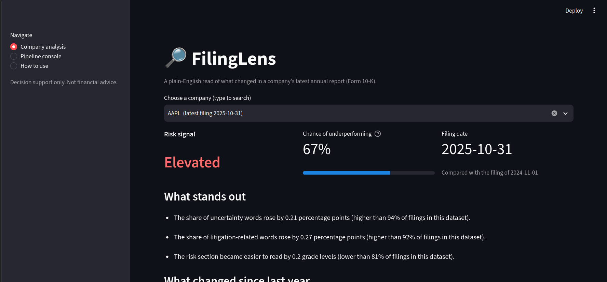
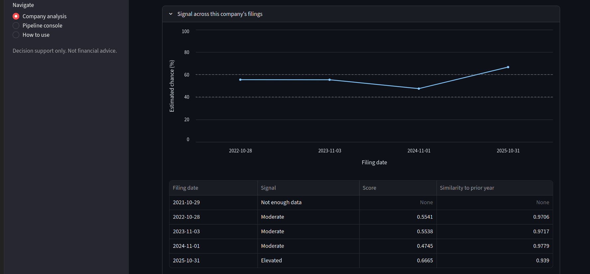
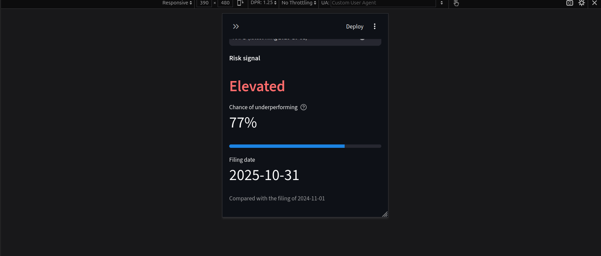
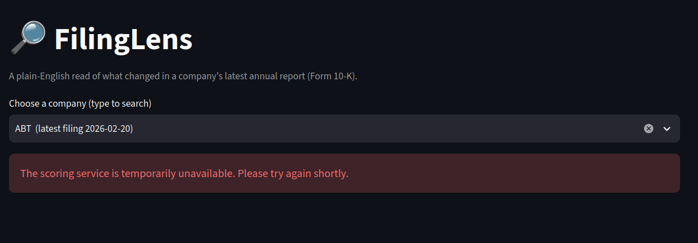
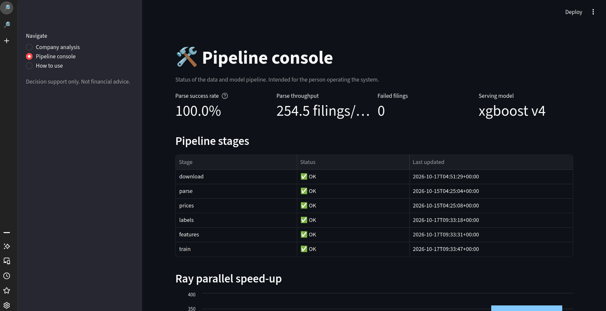

# FilingLens: User Manual

Eshika Nahata (DA24B004) | Version 1.1 | For anyone who wants to understand a company's annual report without reading all of it

## 1. What FilingLens Does

Every year, public companies in the United States publish a long annual report called a **Form 10-K**. Inside it is a section where the company describes the risks it faces. FilingLens compares a company's latest annual report with the one before it and shows you what changed in that risk section, in plain English.

For each company it shows:

- a **risk signal** (Elevated, Moderate, or Lower) with an estimated percentage;
- a short list of **what stands out** about this year's report;
- the **detailed changes** since last year, such as how much longer or shorter the risk section became and whether it uses more words of uncertainty;
- the signal for **earlier years**, so you can see a pattern.

**What it is not.** FilingLens is decision support. It is not financial advice, it does not tell you to buy or sell anything, and it does not predict prices. When the model behind the signal was tested on reports it had not seen, its accuracy could not be told apart from guessing. Please read section 6 before relying on any signal.

## 2. Opening the Application

1. Open a web browser (Firefox, Chrome, Edge or Safari).
2. Go to the address you were given. On the computer where FilingLens is installed it is `http://localhost:8501`.
3. The sidebar on the left has three pages:
   - **Company analysis**: where you look up a company (the main page).
   - **Pipeline console**: a status page for the person who runs the system (section 10).
   - **How to use**: a short help page.

*The Company analysis page before a company is chosen. The sidebar on the left switches between the three pages.*

## 3. Looking Up a Company

**Step 1. Choose a company.** Click the box labelled *Choose a company* and either scroll the list or start typing a ticker symbol such as AAPL. Each entry shows the company and the date of its latest annual report.

**Step 2. Read the risk signal.** At the top you see three things side by side:

- the **risk signal** in colour: red for Elevated, orange for Moderate, green for Lower;
- the **chance of underperforming**, as a percentage with a bar;
- the **filing date**, and the date of the earlier report it was compared with.

**Step 3. Read "What stands out".** One to four sentences point out the biggest differences from last year, for example: *The share of uncertainty words rose by 0.21 percentage points (higher than 93% of filings in this dataset).* If nothing is unusual, it says so.

**Step 4. Look at "What changed since last year".** Six figures give the detail (explained in section 4), followed by two lists of topics that the company gave more or less emphasis.

**Step 5. Open the history.** Click *Signal across this company's filings* to see earlier years (section 5).

*The result for Apple (AAPL): the risk signal and chance of underperforming at the top, then what stands out and the six figures that changed since last year.*

## 4. What Each Figure Means

| What you see | What it means |
| --- | --- |
| **Risk signal: Elevated** | The model estimates a chance of 60% or more that the stock does worse than the overall market in the weeks after the report. |
| **Risk signal: Moderate** | The estimate is between 40% and 60%. |
| **Risk signal: Lower** | The estimate is 40% or less. |
| **Risk signal: Not enough data** | There is no earlier report for this company in our collection, so nothing can be compared. This is not an error. |
| **Chance of underperforming** | The model's estimated probability of doing worse than the US stock market (the S&P 500 index) over roughly the 6 weeks after the report. Move the mouse over the question mark for a reminder. |
| **Filing date** | The day the company filed the report with the US regulator. |
| **Risk section length** | How much longer (+) or shorter (-) the risk section is than last year. +18% means 18% more words. |
| **Wording similarity** | How similar this year's risk wording is to last year's, from 0% (completely different) to 100% (identical). Above 90% means largely unchanged. |
| **Uncertainty language** | The change in the share of words that express uncertainty, such as *may* or *could*. Shown in percentage points: +0.21 pts means a rise of 0.21 percentage points, for example from 1.50% of all words to 1.71%. |
| **Negative-tone language** | The same measure for words with a negative tone, such as *loss* or *decline*. |
| **Litigation-related language** | The same measure for words about lawsuits and legal disputes. |
| **Reading difficulty** | The change in how hard the section is to read, in school grade levels. +0.5 grades means slightly harder to read. |
| **Topics given more or less emphasis** | Words and phrases that count for more or for less in this year's text than in last year's. |

The phrase *higher than 93% of filings in this dataset* compares this report with all the other annual reports in our collection. It describes how unusual a change is. It does not say why it happened or whether it matters.

## 5. The History View

Under the main results, click **Signal across this company's filings**. You see:

- a **line chart** of the estimated chance for each year (shown when at least two years have a score);
- a **table** with one row per annual report: the filing date, the signal, the score, and the similarity to the year before.

The oldest report always shows *Not enough data*, because it has no earlier report to compare with.

*The history view for Apple: the estimated chance for each year as a chart, and the same years in a table.*

## 6. Reading the Results Sensibly

- **Treat the signal as one input among many.** In testing on reports the model had not seen, its predictions were no better than chance. A red *Elevated* does not mean the stock will fall, and a green *Lower* does not mean it is safe.
- **The signal and "what stands out" are separate.** The signal comes from a statistical model. "What stands out" is a plain comparison of this report with last year's. A company can be *Elevated* with nothing unusual in the text, or the reverse.
- **Changes describe, they do not explain.** A longer risk section may mean new risks, or just more careful writing.
- **Only listed companies.** The list covers 54 large US companies. You cannot add your own company or upload a report.
- **Not advice.** Nothing in FilingLens is a recommendation to buy, sell or hold anything.

## 6a. Using a Phone or a Small Window

The page adapts to narrow screens. The three columns at the top stack into a single column, and the figures follow one under another. Tap the arrow at the top left to open the sidebar and change pages. Nothing is cut off.

*The analysis page on a narrow screen: the columns stack into one and nothing is cut off.*

## 7. If Something Goes Wrong

| What you see | What it means | What to do |
| --- | --- | --- |
| *We can't reach the analysis service right now. Please try again in a moment.* | The part of the system that supplies the page is not responding. | Wait a minute and refresh the page. If it stays, tell the person who runs the system. |
| *The scoring service is temporarily unavailable. Please try again shortly.* | The part that calculates the signal is not responding. | Wait a minute and try again, or choose the company again. If it stays, tell the person who runs the system. |
| The company list is empty | The page could not load the list. | Refresh the page. |
| *Not enough data* as a signal | Not an error: this is the company's earliest report in the collection. | Nothing to do. |
| No chart in the history view | A chart needs at least two scored years. | Nothing to do; the table still shows what is available. |

*The friendly message shown when the scoring service is not responding. No technical error text is shown.*

The application never shows technical error text. If you ever see a long technical message, please report it.

## 8. Questions and Answers

**Is this telling me to buy or sell?** No. It highlights what changed in a report. It is not advice.

**Why is a company marked Elevated when nothing stands out?** The signal and the list of what stands out are calculated separately (section 6).

**How up to date is it?** Each company shows the date of its latest report in the list. The data is refreshed by the person who runs the system.

**Why is a company I know missing?** The collection is a fixed list of 54 companies. A few large companies publish their annual reports in a format that FilingLens cannot read reliably, and one was not available from the SEC's data service for the years covered, so they are not included.

**What does "filings in this dataset" mean?** The other annual reports in the collection, across all companies and years.

**Can I trust the percentage?** Treat it as a rough indication. It could not be told apart from a coin toss in testing, and that is why the page repeats the disclaimer.

## 9. Help Inside the Application

The **How to use** page in the sidebar has a short version of this manual, and a note about what the application cannot do.

## 10. For the Person Who Runs the System

The **Pipeline console** page is for the operator, not for the casual reader.

*The top of the Pipeline console: headline numbers, then the status of each pipeline stage.*

It shows:

- the share of reports processed successfully, how fast, and how many failed;
- the **status of each pipeline stage**, with a warning if a stage needs attention;
- how much faster parallel processing is than a single worker;
- the comparison of the trained models, with confidence intervals;
- the **data drift** check: whether the latest reports differ from the ones the model learned from, feature by feature;
- a list of **recent events** such as drift checks, retraining and model changes;
- four live monitoring panels, with links to the full Grafana, MLflow and Prometheus tools.

**Starting and stopping.** From the project folder on the computer that hosts FilingLens:

- start: `docker compose up -d` (wait about 40 seconds);
- stop: `docker compose down`;
- check: `docker compose ps` should show seven services running, with three marked healthy.

**Monitoring tools.** Grafana (`http://localhost:3000`) can be viewed without logging in; to change a dashboard, log in as `admin` with the password set in the `.env` file on the host computer. Prometheus (`http://localhost:9090`) shows the alert rules, and cAdvisor (`http://localhost:8080`) shows each service's use of the computer's memory and processor.

**Model safety check.** Before the scoring service starts, it checks that the model file has not been changed since it was produced. If the check fails, the service does not start and the application shows the *scoring service is temporarily unavailable* message. Restore the model with `dvc checkout models/champion` and restart the service with `docker compose restart model-server`.

**About the data.** A report describing the collection of annual reports (how many per company and year, data-quality checks and charts) is in `reports/eda/eda.md` in the project folder. It is regenerated every time the data is refreshed.

If the page reports that a service is unavailable, run `docker compose ps` to see which service stopped and `docker compose logs <service>` to see why. Further operating commands, including retraining and rolling back a model, are in the project README.

## 11. Glossary

| Term | Meaning |
| --- | --- |
| **Form 10-K** | The annual report that a US public company files with the regulator |
| **Risk section** | The part of the report where the company describes the risks it faces (called Item 1A) |
| **Filing date** | The day the report was filed |
| **Underperforming** | Doing worse than the overall US stock market over the same period |
| **Percentage point** | The difference between two percentages: going from 1.5% to 1.7% is 0.2 percentage points |
| **Wording similarity** | A score from 0% to 100% for how alike two texts are |
| **Grade level** | The school grade a reader would need to understand the text easily |
| **Model** | The statistical program that turns the changes in a report into the signal |
| **Drift** | When new reports look different from the ones the model learned from |
