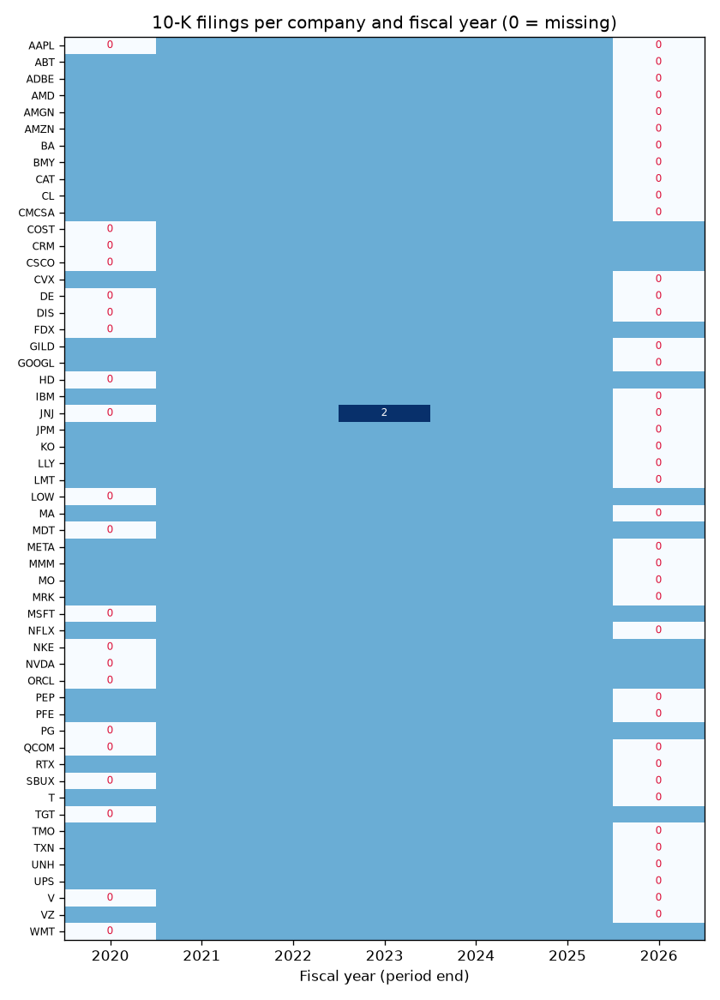
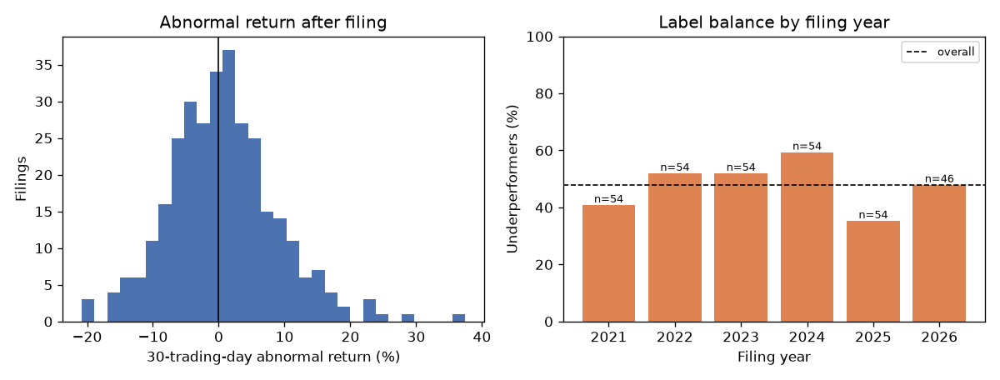
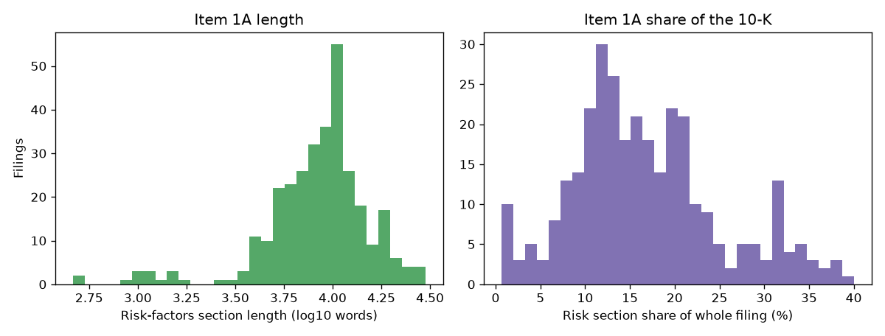
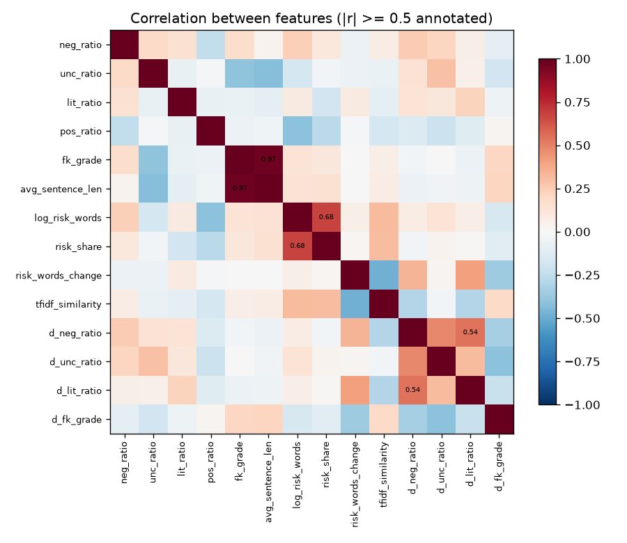
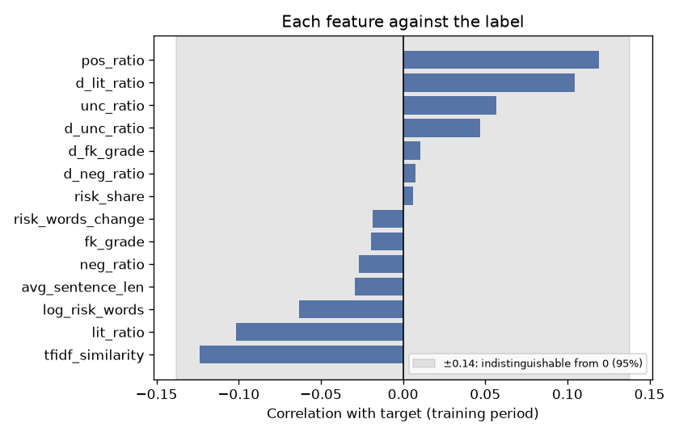
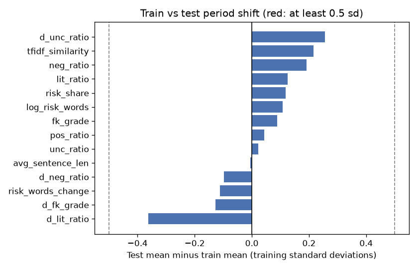

# FilingLens: Exploratory Data Analysis

Generated by the DVC stage `eda` (`python -m src.analysis.eda`) from the current pipeline outputs. Do not edit by hand: rerun `dvc repro eda` instead.

## 1. Key findings

- **Coverage.** 318 filings from 54 companies. 0 companies with fewer than two filings (no year-over-year comparison possible); 0 missing years between a company's first and last filing.
- **Quality.** Parse failures: 0. Manifest statuses: downloaded 318.
- **Label balance.** 316 filings are labeled; 47.8% underperformed the benchmark, so the classes are balanced and accuracy against the majority class is a fair baseline.
- **Modelling sample.** 264 filings have a prior-year filing; after the time split and embargo, 202 are used for training and 58 for testing.
- **Signal.** The strongest single feature-label correlation in the training period is -0.124 (`tfidf_similarity`). With 202 training filings, correlations inside ±0.138 cannot be told apart from zero at the 95% level; 0 of 14 features fall outside it, about what chance alone would produce across 14 tests. This anticipates the model result: weak or no detectable signal.
- **Redundancy.** 1 feature pair with |correlation| of at least 0.7: `fk_grade`/`avg_sentence_len` 0.97. The models use regularisation (logistic regression) and shallow trees (XGBoost), which tolerate this.
- **Train vs test.** The largest shift between periods is -0.36 training standard deviations (`d_lit_ratio`). Shifts are tracked formally by the `drift` stage (PSI and KS test).

## 2. Coverage and data quality

Filings per company and fiscal year (year of the period end). Because the download window is defined by filing date, the first column only holds reports filed after the window opened, and the last column only companies whose latest fiscal year has already ended. A 2 usually means a 52/53-week fiscal year that ended in the first days of January, putting two period ends in one calendar year. Missing years in the middle of the chart, or a company with far fewer filings than the others, point to a download problem.

| Check | Result |
|---|---|
| Companies | 54 |
| Filings parsed | 318 |
| Companies with fewer than 2 filings | 0 |
| Companies with far fewer filings than the median (6) | none |
| Missing years between a company's first and last filing | 0 |
| Parse failures | 0 |
| Filings without a label yet | 2 |
| Filings without a prior-year filing | 54 |

## 3. Label

Abnormal return: mean +0.73%, median +0.34%, standard deviation 8.25%. The target is 1 when the abnormal return is negative. Returns over 30 trading days are dominated by market noise, which is why a weak model result is expected.

## 4. Risk-section text

Item 1A length: median 9,359 words (range 465 to 29,952); median share of the whole filing 15.5%. Lengths are right-skewed, which is why the model uses the logarithm of the word count.

## 5. Features

Summary over filings with a prior-year filing (the rows used for modelling). `outliers_%` counts values beyond 1.5 interquartile ranges; they are kept, because large changes are exactly what the application highlights.

|  | group | missing_% | mean | std | min | median | max | outliers_% |
|---|---|---|---|---|---|---|---|---|
| neg_ratio | word share | 0 | 0.0443 | 0.007 | 0.0153 | 0.044 | 0.0635 | 3.409 |
| unc_ratio | word share | 0 | 0.0318 | 0.0044 | 0.0197 | 0.0323 | 0.0426 | 4.545 |
| lit_ratio | word share | 0 | 0.0178 | 0.0042 | 0.0076 | 0.0178 | 0.0305 | 0.7576 |
| pos_ratio | word share | 0 | 0.0084 | 0.0021 | 0.004 | 0.0082 | 0.0188 | 1.515 |
| fk_grade | readability | 0 | 19.84 | 1.864 | 15.83 | 19.49 | 24.84 | 0.3788 |
| avg_sentence_len | readability | 0 | 32.43 | 4.649 | 22.36 | 31.87 | 43.97 | 0 |
| log_risk_words | length | 0 | 9.038 | 0.6282 | 6.144 | 9.158 | 10.31 | 4.545 |
| risk_share | length | 0 | 0.17 | 0.0829 | 0.0068 | 0.1575 | 0.4004 | 2.651 |
| risk_words_change | year-over-year | 0 | 0.0777 | 0.6144 | -0.8815 | 0.0247 | 8.408 | 12.5 |
| tfidf_similarity | year-over-year | 0 | 0.9399 | 0.066 | 0.4596 | 0.9577 | 0.9999 | 8.712 |
| d_neg_ratio | year-over-year | 0 | 0.0007 | 0.0029 | -0.014 | 0.0004 | 0.0192 | 7.197 |
| d_unc_ratio | year-over-year | 0 | -0 | 0.0022 | -0.0164 | -0 | 0.0119 | 7.576 |
| d_lit_ratio | year-over-year | 0 | 0.0005 | 0.0019 | -0.0087 | 0.0003 | 0.0138 | 9.47 |
| d_fk_grade | year-over-year | 0 | 0.1348 | 0.6 | -3.359 | 0.106 | 3.964 | 7.955 |

## 6. Features against the label

|  | correlation |
|---|---|
| tfidf_similarity | -0.1239 |
| pos_ratio | 0.1192 |
| d_lit_ratio | 0.1045 |
| lit_ratio | -0.1014 |
| log_risk_words | -0.0632 |
| unc_ratio | 0.0568 |
| d_unc_ratio | 0.047 |
| avg_sentence_len | -0.0293 |
| neg_ratio | -0.0271 |
| fk_grade | -0.0195 |
| risk_words_change | -0.0183 |
| d_fk_grade | 0.0104 |
| d_neg_ratio | 0.0077 |
| risk_share | 0.0061 |

## 7. Training period against test period

|  | shift_sd |
|---|---|
| d_lit_ratio | -0.363 |
| d_unc_ratio | 0.256 |
| tfidf_similarity | 0.216 |
| neg_ratio | 0.191 |
| d_fk_grade | -0.128 |
| lit_ratio | 0.126 |
| risk_share | 0.118 |
| risk_words_change | -0.111 |
| log_risk_words | 0.107 |
| d_neg_ratio | -0.097 |
| fk_grade | 0.089 |
| pos_ratio | 0.043 |
| unc_ratio | 0.023 |
| avg_sentence_len | -0.005 |
